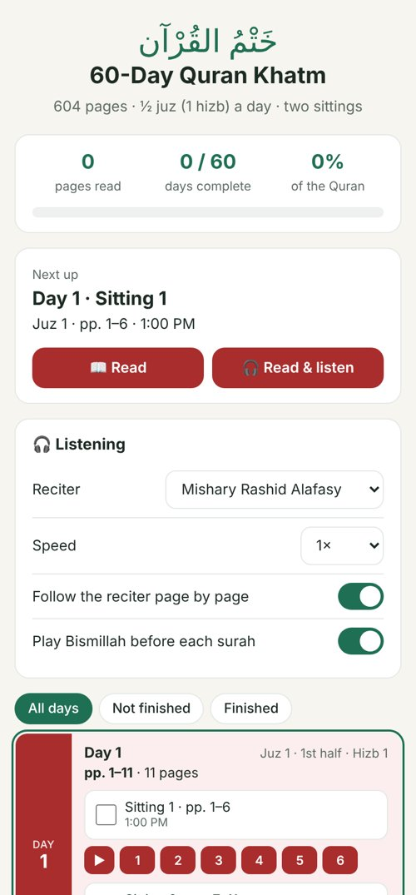
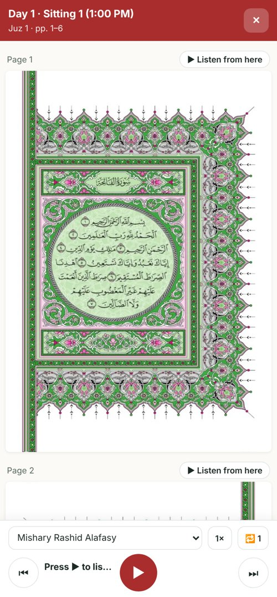

<h1 align="center">📖 60-Day Quran Khatm</h1>

<p align="center">
  <b>Read and listen to the whole Quran in 60 days: half a juz (one hizb) a day, split into two sittings.</b>
</p>

<p align="center">
  <a href="https://hashrash-dev.github.io/khatm60/"></a>
  
</p>

<p align="center">
  
  
  
  
  
</p>

<p align="center">
  
  &nbsp;&nbsp;
  
</p>

---

## ✨ Features

- **Structured 60-day plan**: the 604-page Madani mushaf divided into 60 days × 2 sittings
- **Built-in mushaf pages**: no external page source needed
- **Verse-by-verse recitation** with a choice of reciters, via the [Al Quran Cloud](https://alquran.cloud) API
- **Auto page-follow**: pages turn along with the recitation
- **Playback controls**: speed, verse repeat, and optional Bismillah before each surah
- **Progress tracking** for all 60 days, saved locally on the device (no account needed)
- **Installable PWA**: add to your home screen on Android or iOS; pages you've opened work offline

## 🚀 Getting Started

### Use it
Open **[hashrash-dev.github.io/khatm60](https://hashrash-dev.github.io/khatm60/)** in your browser. On a phone, choose **Install app** (or *Add to Home Screen*) to use it like a native app.

### Run it locally
No build step or dependencies. It's plain HTML, CSS and JavaScript.

```bash
git clone https://github.com/Hashrash-dev/khatm60.git
cd khatm60
python3 -m http.server 8000
# then open http://localhost:8000
```

> A local web server is required (not `file://`) so the service worker and manifest load correctly.

## 🗂️ Project Structure

```
khatm60/
├── index.html             # App shell, layout and styles
├── app.js                 # Reading plan, player, progress tracking
├── sw.js                  # Service worker for offline caching
├── manifest.webmanifest   # PWA metadata (name, icons, theme)
├── icons/                 # App and home-screen icons
├── s/                     # Mushaf page images (WebP)
└── docs/                  # README screenshots
```

## 🛠️ How It Works

| Piece | Role |
|---|---|
| **Reading plan** | Maps each of the 60 days and 2 sittings to its juz, hizb, and page range |
| **Audio** | Streams verse-level recitation from the Al Quran Cloud API for the selected reciter |
| **Storage** | Saves progress and settings in the browser's `localStorage` |
| **Offline** | The service worker caches the app shell and every page you've viewed |

## 🙏 Acknowledgements

- Recitation audio and verse data: [Al Quran Cloud API](https://alquran.cloud)
- Fonts: [Amiri](https://fonts.google.com/specimen/Amiri) and [Inter](https://fonts.google.com/specimen/Inter) via Google Fonts

## 👤 Author

**Hashim Abdul**: [@Hashrash-dev](https://github.com/Hashrash-dev)

If you find this useful, please consider giving the repo a ⭐.
